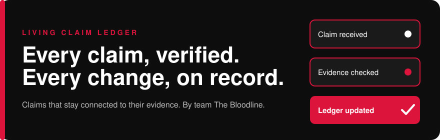
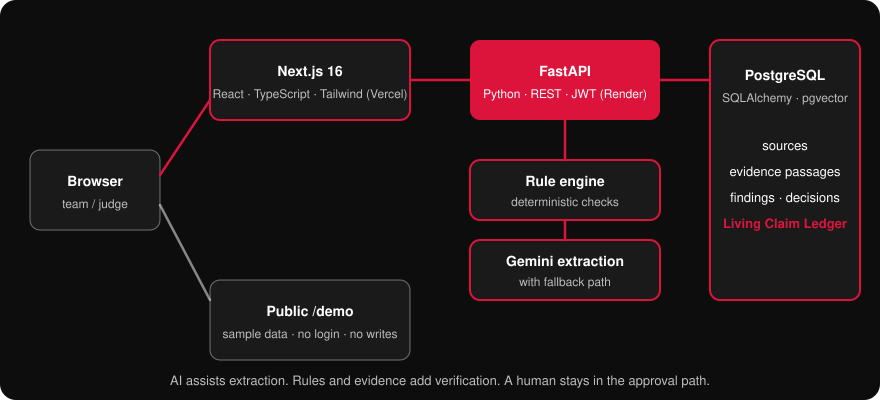
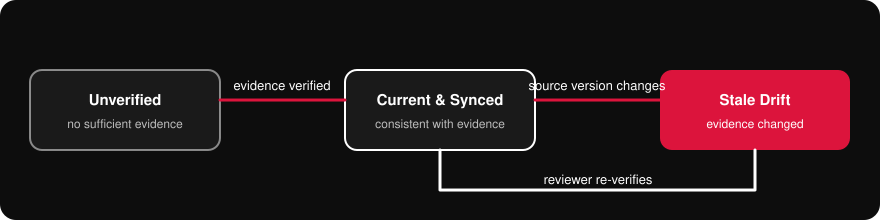
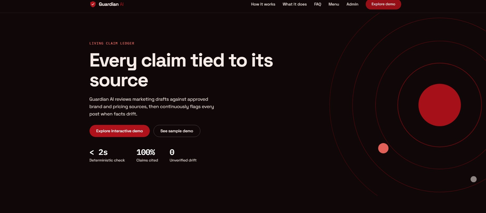
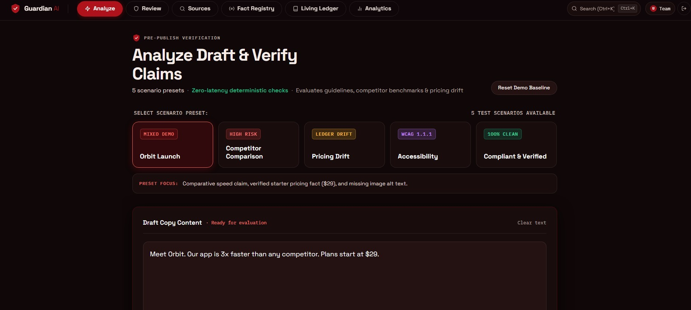
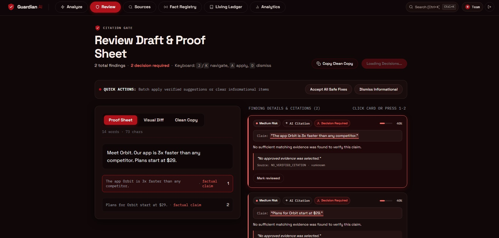
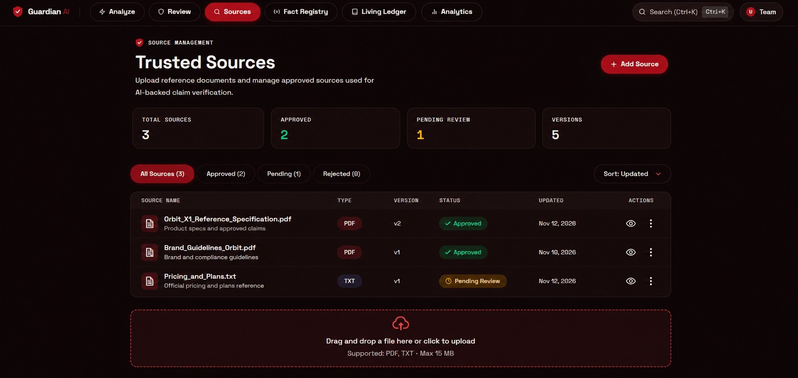
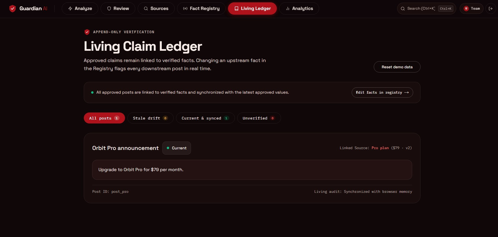

<div align="center">

<!-- Logo: docs/assets/guardian-symbol.svg (black shield, crimson ring, white core: reads on light and dark themes). -->


<!-- Headings are SVGs: add the text to the list in docs/assets/headings/render.mjs, then run `node docs/assets/headings/render.mjs`. -->
<h1 align="center"><a id="guardian-ai"></a></h1>

<p align="center"><b>The Living Claim Ledger</b><br>Claims that stay connected to their evidence.</p>



<br>

[](#team)
[](#team)
[](https://github.com/Varun-men/Guardian_AI/commits)
[](#tech-stack)
[](#tech-stack)
[](#tech-stack)

[Try the demo](https://guardian-ai-smoky-theta.vercel.app/demo) · [How it works](#how-it-works) · [The ledger](#the-living-claim-ledger) · [Screenshots](#product-in-pictures) · [Run it](#run-it-locally) · [Team](#team)

</div>

<h2><a id="what-this-is"></a></h2>

Guardian AI checks every factual claim in marketing content against approved evidence, keeps a human in charge of approval, and remembers each approved claim in a **Living Claim Ledger**, so it can flag the claim when the evidence changes.

It extracts claims from a draft, checks them with deterministic rules and against approved sources, and puts every finding in front of a human reviewer. The backend refuses approval while decisions are pending. Approved facts are then stored with their evidence and source versions, and the ledger shows which claims need renewed verification.

| Pillar | What it means |
|---|---|
| Evidence-backed | Claims are checked against passages from approved sources, with source versions and citations kept. |
| Human-controlled | Reviewers apply or dismiss each finding. The backend blocks approval while decisions are pending. |
| Persistent | The ledger keeps approved facts connected to their evidence and flags **Stale Drift**. |

<h2><a id="the-problem"></a></h2>

Marketing and product teams publish claims about products, pricing, specifications and features. When product information changes, those claims quietly go stale. A one-time proofread cannot show which source a claim depends on.

```
Without a ledger   draft → one-time proofread → publish → source changes → nobody knows which posts are now wrong
With Guardian AI   draft → claims extracted → checked against evidence → human approves → ledger remembers
                   the source version → source changes → affected claims flagged Stale Drift
```

<h2><a id="how-it-works"></a></h2>



1. **Submit content.** A user submits marketing or product content.
2. **Extract claims.** Gemini-based extraction finds the individual factual claims, with a fallback path if it is unavailable.
3. **Check.** A deterministic rule engine flags restricted wording, competitor references, pricing inconsistencies and missing alt text. Evidence retrieval matches each claim to passages from approved sources and marks it supported, contradicted or unverified.
4. **Review.** The reviewer sees explanations, evidence, severity, verification status and suggested corrections, then applies or dismisses each finding. Decisions are saved.
5. **Approve.** The backend refuses approval while required decisions are pending.
6. **Remember.** Approved facts are stored with their claims, evidence passages and source versions in the ledger.
7. **Track.** When a source or approved value changes, the affected claims are flagged **Stale Drift**.

<h2><a id="the-living-claim-ledger"></a></h2>

The ledger is a persistent registry of approved facts. It links each fact to the claims that rely on it, the evidence behind it and the source version that evidence came from.



| Status | Meaning |
|---|---|
| **Current & Synced** | The claim is consistent with its linked evidence. |
| **Stale Drift** | The supporting evidence changed or became outdated, so the claim needs renewed review. |
| **Unverified** | The claim has no sufficient verified evidence. It is never assumed correct. |

Illustrative walk-through, based on the demo's Orbit Pro entry:

| Step | Linked source | Claim in the ledger | Status |
|---|---|---|---|
| 1. Approved today | Pro plan · $79 · v2 | "Upgrade to Orbit Pro for $79 per month." | Current & Synced |
| 2. Source updated to v3 | Pro plan · changed value · v3 | Same published text, now out of step | Stale Drift |
| 3. Reviewer re-verifies | Pro plan · v3 | Copy corrected, approved against v3 | Current & Synced |

<h2><a id="features"></a></h2>

- **AI-assisted analysis:** extracts individual factual claims, gives each finding a unique ID, and keeps verification status separate from severity.
- **Deterministic rules:** restricted wording, competitor references, pricing inconsistencies and accessibility issues, kept distinct from evidence-backed verification.
- **Evidence intelligence:** upload reference documents, store evidence passages, and trace claim → passage → source version, with citation validation.
- **Review workspace:** Apply or Dismiss with persisted decisions, suggested corrections, controlled draft updates and review history.
- **Living Claim Ledger:** the centrepiece. Facts, claims, evidence and source versions with three statuses.
- **Authentication and admin:** JWT-protected team workflows, source management and backend-enforced approval.
- **Public demo:** `/demo` runs on sample data with no login, separate from the authenticated app.

<h2><a id="responsible-by-design"></a></h2>

- **AI never approves.** Approval is a human decision, enforced by the backend.
- **Certainty where it exists.** Deterministic rules handle rule-based checks and stay distinct from evidence-backed verification.
- **Honest about gaps.** A claim without sufficient evidence is shown as Unverified.
- **Demo kept separate.** The public demo uses sample data and makes no backend writes.

<h2><a id="product-in-pictures"></a></h2>



Homepage. Figures shown on it are illustrative marketing content, not measured results.



Analyze. Pick one of five scenario presets or paste a draft, then run verification.



Review. With no approved evidence selected, a claim is shown as unverified and a decision is required. The product never fills the gap with a guess.



Sources (illustrative UI mockup, not a live upload capture). Every source has a version and an approval status, and the ledger links claims to that version.



Living Claim Ledger. Shown from the public demo, where ledger data is held in the browser. In the authenticated app the ledger is stored in PostgreSQL.

<h2><a id="orbit-x1-scenario"></a></h2>

Orbit X1 is a **synthetic** test product used for validation. A reference document with approved information is uploaded, and a draft with seven factual claims is submitted.

| # | Claim in the draft | Result | Suggested correction |
|---|---|---|---|
| 1 | Battery life of 14 days | Contradicted (approved: up to 10 days) | 10 days |
| 2 | 1.8-inch AMOLED display | Supported | None |
| 3 | Built-in GPS | Supported | None |
| 4 | Water resistance up to 50 metres | Supported | None |
| 5 | Continuous heart-rate monitoring | Supported | None |
| 6 | Price of ₹4,999 | Contradicted (approved: ₹5,499) | ₹5,499 |
| 7 | Available in Black, Blue and Silver | Contradicted (Silver not approved) | Black and Blue |

Four claims are supported and three are contradicted. After the suggested corrections are applied, all seven match the reference. This is a demonstration scenario, not a benchmark, and no accuracy percentage is claimed.

<h2><a id="tech-stack"></a></h2>

| Layer | Tools |
|---|---|
| Frontend | Next.js 16, React, TypeScript, Tailwind CSS, deployed on Vercel |
| Backend | Python, FastAPI, REST API, deployed on Render |
| AI and verification | Gemini-based claim extraction, deterministic rule engine, passage-level evidence matching |
| Database | PostgreSQL, SQLAlchemy, pgvector |
| Auth | JWT |

<h2><a id="try-it-now"></a></h2>

No login needed. Open the [public demo](https://guardian-ai-smoky-theta.vercel.app/demo), then:

1. Open a finding, read its explanation and evidence, and press **Apply** or **Dismiss**. In the demo these only change your own screen.
2. Compare with the Orbit X1 table above.
3. Open the **Living Ledger** tab to see Current & Synced, Stale Drift and Unverified.

| Resource | Link |
|---|---|
| Live application | https://guardian-ai-smoky-theta.vercel.app/ |
| Public interactive demo | https://guardian-ai-smoky-theta.vercel.app/demo |
| GitHub repository | https://github.com/Varun-men/Guardian_AI |
| Backend | https://guardian-ai-1-nhbv.onrender.com |

<h2><a id="run-it-locally"></a></h2>

<!-- Check these folder names and commands against the repo before publishing. -->
You need Node 20+, Python 3.11+, and a PostgreSQL database with the pgvector extension.

```bash
git clone https://github.com/Varun-men/Guardian_AI.git
cd Guardian_AI

# backend
cd backend
pip install -r requirements.txt
uvicorn main:app --reload          # http://localhost:8000

# frontend (new terminal)
cd frontend
npm install
npm run dev                        # http://localhost:3000
```

<h3><a id="setup"></a></h3>

Create a `.env` in the backend folder. Git ignores it, so never commit it.

```bash
DATABASE_URL=postgresql://…
GEMINI_API_KEY=…
JWT_SECRET=any-long-random-string
```

<h2><a id="repository-layout"></a></h2>

```
frontend/     Next.js app: marketing site, analyze, review, sources, ledger, public /demo
backend/      FastAPI service: extraction, rules, evidence retrieval, review, approval, ledger
docs/         the Round 3 report and the images used in this README
```

<h2><a id="scope-and-limitations"></a></h2>

**Does today:** extracts claims and verifies them against uploaded, approved sources. Keeps humans in the approval path, enforced by the backend. Tracks approved claims in a persistent ledger with three statuses.

**Does not do yet:** scheduled background monitoring and notifications, automatic reopening of affected reviews, advanced reviewer assignments and configurable approval chains, live monitoring of external web sources.

The public demo runs on sample data. No test counts, response times, uptime figures or accuracy percentages are claimed.

<h2><a id="roadmap"></a></h2>

Planned work. None of it is implemented yet.

| Phase | Focus | Includes |
|---|---|---|
| 1 | Advanced collaborative workflows | Reviewer assignments, finding-level role permissions, team activity dashboards, configurable approval chains |
| 2 | Scheduled monitoring and notifications | Background monitoring, alerts when evidence changes, review reminders, advanced review reopening |
| 3 | Advanced evidence intelligence | More source formats, better semantic retrieval, conflicting-source identification, confidence indicators, freshness analysis |
| 4 | Integrations and enterprise readiness | CMS and marketing integrations, enterprise access controls, audit exports, advanced team management |

<h2><a id="team"></a></h2>

**The Bloodline**, Inkloom AI Challenge, Round 3: The Finish (November 2026).

| Name | Role |
|---|---|
| Varun Kumar | Lead |
| Udit Das | Team member |
| Sudip Sau | Team member |
| Divya Vashisht | Team member |

<h2><a id="license"></a></h2>

MIT. See [LICENSE](LICENSE).
