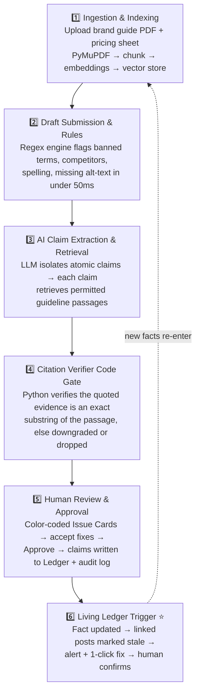

<div align="center">

# 🛡️ Guardian AI

### Brand governance that doesn't stop at approval.

**The Living Claim Ledger** · Team *The Bloodline* · Inkloom AI Challenge


[Live Demo](#-live-demo) · [Problem](#-problem) · [Solution](#-our-solution) · [Architecture](#-architecture) · [Installation](#-installation) · [Results](#-results) · [Team](#-team)

</div>

---

## 🎯 Problem

Brand governance usually ends the moment a post is approved. After that:

- **Approval is a one-time gate.** A post is checked once, against the facts that were true *that day*.
- **Facts change, published posts don't.** When pricing, features, or policies are updated, hundreds of already-approved posts quietly become wrong.
- **Nobody re-reads 1,000 old posts.** Stale claims such as outdated prices stay live until a customer notices.
- **AI reviewers hallucinate.** Tools that review content with an LLM can invent brand rules or "verify" claims with evidence that doesn't exist.
- **There is no audit trail.** Teams can't answer *who approved what, when, and on which evidence*.

## 💡 Our Solution

Guardian AI runs a **dual-stage workflow**: *Pre-publish Multi-gate Review*, followed by *Post-publish Continuous Ledger Monitoring*.

1. Before a post ships, **fast deterministic rules** and a **grounded AI review** flag unsupported or off-brand claims, each with a citation to the exact source passage.
2. When a post is approved, its claims are written to the **Living Claim Ledger** and linked to the underlying facts.
3. When a fact changes (e.g. Starter price **$29 → $39**), every linked post is **automatically flagged stale**, with a one-click fix for a human to confirm.

Every decision is written to an **append-only audit log**.

## ⭐ Two Key Features

### 1️⃣ Pre-publish Review
Creators paste a draft and click **Analyze**. Within seconds they get color-coded **Issue Cards**:

| Severity | Meaning |
|----------|---------|
| 🔴 **HIGH** | Unsupported or risky claim (e.g. "3x faster than any competitor") |
| 🟡 **MEDIUM** | Needs attention or human judgement |
| 🟢 **SUPPORTED** | Claim verified against an approved source (e.g. Pricing Sheet v2) |
| 🔵 **ACCESSIBILITY** | Deterministic WCAG check (e.g. image missing alt text) |

Each card shows the flagged text, the **cited source passage**, an explanation, a **suggested fix** (one-click accept), and a confidence score.

### 2️⃣ Living Claim Ledger
Approved claims are stored in the ledger and linked to facts through a shared `fact_id`. When an admin changes a fact, the dashboard raises an alert such as *"1 Approved Post Contains Outdated Pricing"* and shows the exact post with a **1-click update**. A human reviews and confirms. Nobody has to re-read old posts, because Guardian AI tracks every claim back to its source.

## 🏗️ Architecture

### Six-Stage Pipeline



| # | Stage | What actually happens in code |
|---|-------|-------------------------------|
| 1 | **Ingestion & Indexing** | Admin uploads the Brand Guidelines PDF and Pricing Sheet. PyMuPDF extracts text, chunks it into passages, stores embeddings in the vector table, and saves verified fact key-values. |
| 2 | **Draft Submission & Rules** | Creator submits a draft. A deterministic regex engine instantly flags banned competitor names, spelling errors, and missing image alt-text in under 50 ms, with no LLM latency. |
| 3 | **AI Claim Extraction & Retrieval** | Draft text goes to the LLM to isolate atomic claims. Each claim queries the vector DB for only the relevant permitted passages, so the model cannot invent brand rules. |
| 4 | **Citation Verifier Code Gate** | The model proposes a verdict and quoted evidence. A Python gate checks the quote is an *exact substring* of the retrieved passage. Unverified quotes are downgraded to "Needs human judgement" or dropped. |
| 5 | **Human Review & Approval** | Reviewer examines Issue Cards, accepts suggested edits, and approves. The API checks the user's role and writes the decision to the audit log. |
| 6 | **Living Ledger Trigger** | Admin updates a fact. The backend finds linked content in `claim_ledger`, marks it **stale**, logs the change, and the UI highlights affected posts with 1-click fixes. |

### Repository Structure (Monorepo, four ownership zones)

```text
guardian-ai/
├── frontend/              # Next.js (App Router), Tailwind CSS, Lucide-React, Axios/SWR
├── backend/
│   ├── main.py            # FastAPI app, CORS middleware, global routes
│   ├── db/                # PostgreSQL models: Sources, Facts, Drafts, ClaimLedger, Users, AuditLog
│   ├── auth/              # Login, roles (admin / creator / reviewer), audit-logging helpers
│   ├── pipeline/          # LLM claim extractor, vector retriever, citation verifier gate
│   └── rules/             # Deterministic regex checks, WCAG alt-text rule engine
└── seed_data/             # Orbit brand guide PDF, pricing_v2.json, 15 labelled test posts
```

### Frozen Data Contract

The frontend and backend are built in parallel against this fixed response from `POST /api/review/analyze`. The ledger link field is named **`fact_id`** everywhere (API, database, UI).

<details>
<summary><b>View example response</b></summary>

```json
{
  "draft_id": "uuid-1234",
  "content": "Meet Orbit. Our app is 3x faster than any competitor. Plans start at $29.",
  "status": "in_review",
  "issues": [
    {
      "id": "iss_1",
      "claim_id": "clm_1",
      "severity": "HIGH",
      "category": "COMPARATIVE_CLAIM",
      "check_type": "AI",
      "flagged_text": "Our app is 3x faster than any competitor.",
      "passage_id": "POLICY_V2_SEC_4",
      "source_version": "v2",
      "cited_evidence": "All comparative claims require a documented benchmark.",
      "explanation": "No approved benchmark found in knowledge base.",
      "suggested_fix": "Our app is built for speed.",
      "confidence": 0.82,
      "needs_human_decision": true,
      "fact_id": null
    },
    {
      "id": "iss_2",
      "claim_id": "clm_2",
      "severity": "SUPPORTED",
      "category": "APPROVED_VALUE",
      "check_type": "RULE",
      "flagged_text": "Plans start at $29.",
      "passage_id": "PRICING_V2",
      "source_version": "v2",
      "cited_evidence": "Starter plan: $29/mo",
      "explanation": "Matches Pricing Sheet v2 (verified).",
      "suggested_fix": null,
      "confidence": 1.0,
      "needs_human_decision": false,
      "fact_id": "fact_starter_price"
    },
    {
      "id": "iss_3",
      "claim_id": null,
      "severity": "ACCESSIBILITY",
      "category": "MISSING_ALT_TEXT",
      "check_type": "RULE",
      "flagged_text": "orbit-hero.png",
      "passage_id": "WCAG_1_1_1",
      "source_version": "v1",
      "cited_evidence": "Images need a text alternative.",
      "explanation": "Deterministic check: image has no alt text.",
      "suggested_fix": "Add a short description of the image.",
      "confidence": 1.0,
      "needs_human_decision": false,
      "fact_id": null
    }
  ]
}
```
</details>

## 🛠️ Tech Stack

| Layer | Technology |
|-------|------------|
| **Frontend** | Next.js (App Router), Tailwind CSS, Lucide-React, Axios / SWR |
| **Backend** | Python, FastAPI, Pydantic, CORS middleware |
| **AI / LLM** | LLM with structured JSON output for atomic claim extraction; grounded verification prompt that abstains when there is no evidence; code-based Citation Verifier |
| **Retrieval** | PyMuPDF for PDF parsing; vector passage search (ChromaDB or pgvector) |
| **Database** | PostgreSQL via SQLAlchemy / Supabase (Sources, Facts, Drafts, ClaimLedger, Users, AuditLog) |
| **Rules Engine** | Deterministic regex (banned words, competitor names, pricing) and WCAG alt-text check |
| **Deployment** | Vercel (frontend), Render / Railway (backend) |

## 🚀 Installation

### Prerequisites
- Python 3.10+
- Node.js 18+ and npm
- PostgreSQL (or a Supabase project)
- An LLM API key

### 1. Clone
```bash
git clone https://github.com/Varun-men/Guardian_AI.git
cd Guardian_AI
```

### 2. Backend
```bash
cd backend
python -m venv venv
source venv/bin/activate          # Windows: venv\Scripts\activate
pip install -r requirements.txt

cp .env.example .env              # then fill in the values below
uvicorn main:app --reload --port 8000
```
Check it's running: `http://localhost:8000/health` should return **200 OK**.

### 3. Frontend
```bash
cd frontend
npm install
cp .env.example .env.local        # set NEXT_PUBLIC_API_URL=http://localhost:8000
npm run dev
```
Open `http://localhost:3000`.

### 4. Seed the data
Load the fictional **Orbit** brand assets so the demo works end to end:
```bash
# from /backend
python -m seed_data.load          # EDIT: use your actual seed/ingestion command
```

### Environment variables
| Variable | Description |
|----------|-------------|
| `DATABASE_URL` | PostgreSQL / Supabase connection string |
| `LLM_API_KEY` | API key for the LLM provider |
| `CORS_ORIGINS` | Allowed frontend origin(s) |
| `NEXT_PUBLIC_API_URL` | Backend URL used by the frontend |

> ⚠️ Backend entry command and env variable names are assumed from the blueprint. Adjust them to match the code.

### Run the evaluation
```bash
python test_eval.py               # runs the 15 labelled posts, prints precision/recall
```

## 📊 Results

Measured on **15 labelled test posts** (fictional Orbit brand). Evaluation script: `test_eval.py`.

| Metric | Target | Measured |
|--------|--------|----------|
| Rule-engine latency | < 50 ms | <!-- EDIT: __ ms --> |
| Precision (15 labelled cases) | – | <!-- EDIT: __% (n=15) --> |
| Recall (15 labelled cases) | – | <!-- EDIT: __% (n=15) --> |
| Ledger impact accuracy | – | <!-- EDIT: __% --> |
| Citation validity rate | No unverified citation ever shown as "verified" | <!-- EDIT: __% --> |

**Notes:** <!-- EDIT: sample size, labelling method, model version, date run -->

## ⚠️ Limitations

> Review and edit these so they match what is actually true of your final build.

- **Small evaluation set.** Results come from 15 labelled posts, so they show the system works but don't prove it generalises.
- **Fictional brand data.** The knowledge base is built from the invented *Orbit* brand guide and pricing sheet, not a real company's documents.
- **Rules are pattern-based.** Regex checks catch known banned terms and prices, but not paraphrased or implied claims.
- **Citation gate checks existence, not meaning.** It proves a quote is an exact substring of the passage, but not that the passage truly supports the claim, so weak evidence is routed to human judgement.
- **LLM can miss claims.** Atomic claim extraction may overlook implied or visual claims.
- **Human sign-off is required.** Guardian AI assists reviewers and does not replace them.
- **Scope.** <!-- EDIT: e.g. text posts only, English only, no image content analysis beyond alt-text -->

## 👥 Team

**Team: The Bloodline**

| Member | Role & Ownership | Directory |
|--------|------------------|-----------|
| **Varun Kumar** (Team Lead) | Frontend, UI/UX & Deployment | `/frontend/` |
| **Divya Vashisht** | Backend Core, Ledger Engine, Auth & Audit | `/backend/api/`, `/backend/db/`, `/backend/auth/` |
| **Udit Das** | AI Pipeline & Citation Gate | `/backend/pipeline/` |
| **Sudip Sau** | Deterministic Rules & Evaluation | `/backend/rules/`, `/seed_data/` |

<!-- EDIT: add GitHub profile links for each member -->

## 🌐 Live Demo

| | Link |
|---|------|
| 🔗 **Frontend (Vercel)** | <!-- EDIT: https://your-app.vercel.app --> |
| ⚙️ **Backend API (Render/Railway)** | <!-- EDIT: https://your-api.onrender.com/docs --> |
| 🎥 **Demo video** | <!-- EDIT: link --> |

### 3-Minute Demo Flow

1. **Pre-publish governance:** Paste *"Meet Orbit. 3x faster than any competitor. Plans start at $29."* and click **Analyze**. Three cards appear: 🔴 "3x faster" flagged with its policy passage, 🟢 "$29" verified against Pricing Sheet v2 and linked to the Ledger, 🔵 missing hero-image alt text caught. Approve the post, and the decision is written to the audit log.
2. **Post-publish stale claims:** Two months later, an admin changes the Starter price from **$29 to $39**. The Living Claim Ledger raises *"1 Approved Post Contains Outdated Pricing"* and offers a one-click update to "Plans start at $39".
3. **Trust & explainability:** Ungrounded claims are downgraded to *"Needs human judgement"*, never asserted. The measured evaluation results are shown with sample size and known limitations.

## 🤝 Contributing

We use a single monorepo with strict folder ownership to avoid merge conflicts.

| Branch | Owner | Directory |
|--------|-------|-----------|
| `main` | Protected, always deployable | Whole repo |
| `feature/frontend` | Varun | `/frontend/` |
| `feature/backend-core` | Divya | `/backend/db/`, `/backend/auth/`, `main.py` |
| `feature/ai-pipeline` | Udit | `/backend/pipeline/` |
| `feature/rules-data` | Sudip | `/backend/rules/`, `/seed_data/` |

1. Branch from `main`
2. Work only in your own directory
3. Test locally, then open a Pull Request into `main`

## 👥 Contributors

<a href="https://github.com/Varun-men/Guardian_AI/graphs/contributors">
  
</a>

## ⭐ Star History

[](https://star-history.com/#Varun-men/Guardian_AI&Date)

## 📄 License

<!-- EDIT: e.g. MIT. Add a LICENSE file so the license badge works -->

<div align="center">

**Guardian AI: because approval is where governance begins.**

⭐ Star the repo if you like the idea!

</div>
